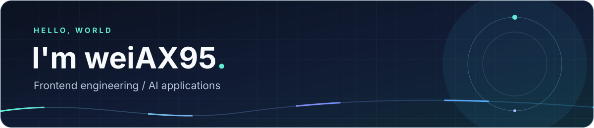

### 前端工程化 · AI 应用 · 实现与验证
Frontend engineering · AI applications · Building & validating

关注前端工程化与 AI 应用，记录实现、验证和改进过程。 
Exploring frontend engineering and AI applications through practical projects and careful iteration.

---

## 精选项目 · Selected projects

| 项目 / Project | 正在探索 / Focus | 阶段 / Stage |
| :--- | :--- | :--- |
| **[LLM Agent](https://github.com/weiAX95/agent)** | FastAPI / LangGraph 流式聊天、PostgreSQL 会话恢复与 Milvus 长期记忆 Streaming chat, conversation recovery & long-term memory | 实验阶段 / Experimental |
| **[React CLI Tool](https://github.com/weiAX95/react-cli-tool)** | React / TypeScript / Webpack 项目生成与构建模板 Project generation & build templates | 脚手架练习 / Learning project |
| **[React Frame](https://github.com/weiAX95/react-frame)** | React / TypeScript 构建、路由、状态与测试配置 Build, routing, state & test configuration | 工程化学习 / Learning project |

> 项目仍在学习或实验阶段；具体运行方式与已知限制请以各仓库 README 为准。  
> These are learning and experimental projects; see each repository's README for setup and known limitations.

## 当前关注 · Current focus

- **AI 应用 / AI applications** — 会话持久化、记忆召回与流式错误恢复 / Conversation persistence, memory recall & streaming recovery.
- **前端工程化 / Frontend engineering** — 构建配置、类型检查与可重复的验证流程 / Build configuration, type checking & repeatable verification.

## 学习与实验 · Notes & experiments

[类型生成实验 / Type generation](https://github.com/weiAX95/auto-create-tsfile-cli) · [订单簿学习 / Order book study](https://github.com/weiAX95/orderbook) · [TypeScript 学习 / TypeScript study](https://github.com/weiAX95/typescript-learning) · [全部仓库 / All repositories](https://github.com/weiAX95?tab=repositories)
